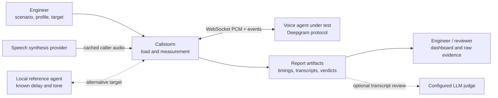
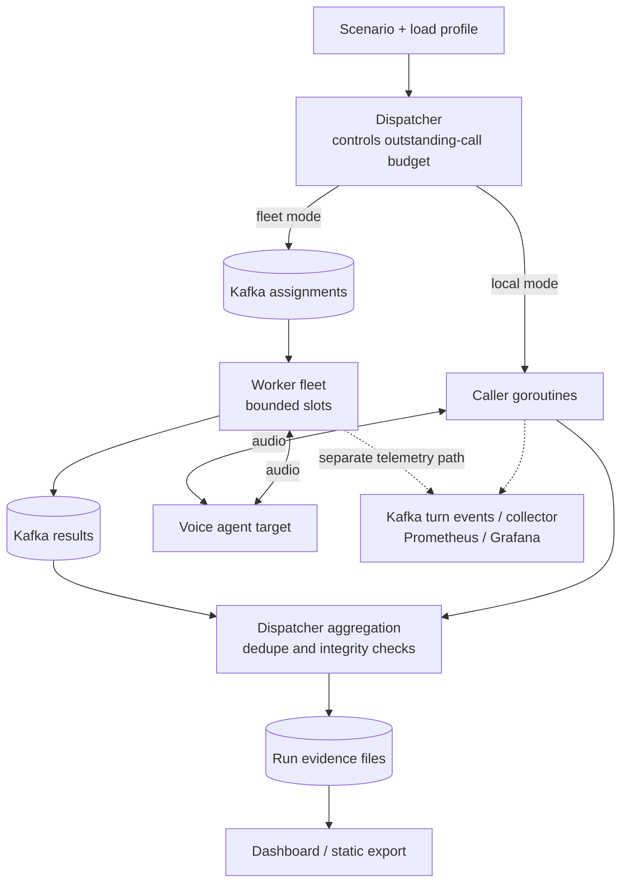
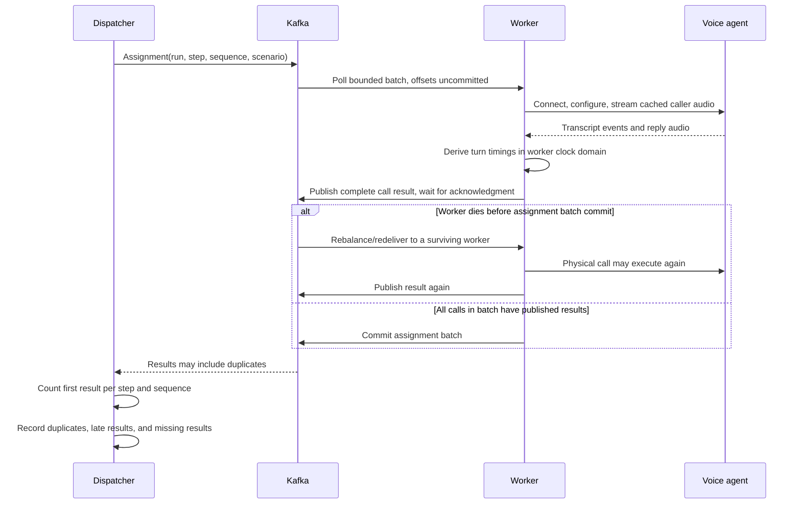
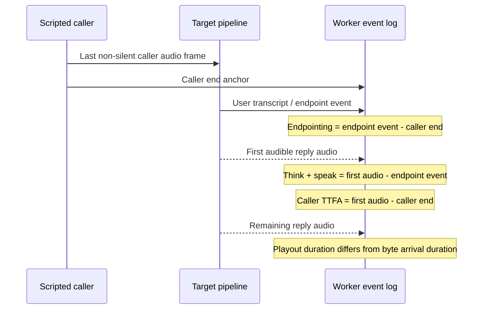
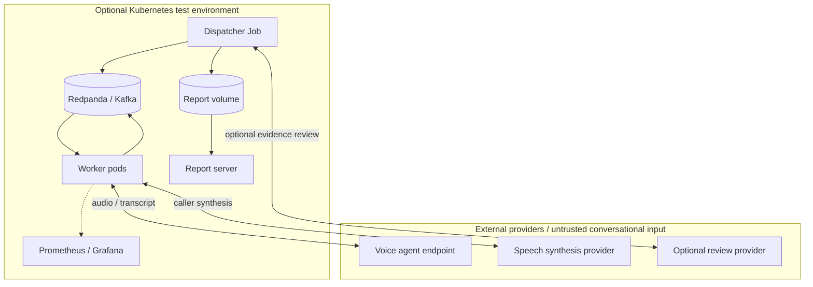

# Callstorm architecture

**A measurement system has to explain its own errors before it can explain the system under test.**

Callstorm places scripted audio calls against a Deepgram-compatible voice-agent endpoint. Its design separates
load control, real-time audio, evidence collection, and interpretation so that a slow collector or an optimistic
judge cannot silently turn a bad call into a good result.

This guide describes the implemented system. The alternative designs below explain its tradeoffs; they do not
claim that every alternative was built or benchmarked. [Run instructions](README.md) ·
[Measurement definitions](docs/technical-guide.md) · [Recorded experiments](docs/engineering-report.md).

## 1. Constraints that shape the design

| Quality attribute | Concrete requirement | Mechanism | Cost accepted |
| --- | --- | --- | --- |
| Measurement integrity | Timing work must not wait for analytics | Per-call clocks, paced audio, asynchronous turn telemetry | Telemetry delivery can fail; loss must be counted |
| Reproducibility | Two runs should hear the same caller input | Cached speech keyed by voice, sample rate, and text | Cache distribution and provider setup remain operational concerns |
| Controlled load | A stage should represent its requested concurrency | A bounded window of outstanding calls | This is a closed-loop workload, not a fixed arrival-rate generator |
| Recoverability | A worker crash must leave unfinished work replayable | Manual Kafka batch commits after result publication | Physical calls may run more than once |
| Explainability | A verdict must lead back to the call and its clock | JSON reports, per-call logs, explicit metric definitions | More artifacts to retain and review before sharing |

## 2. System context

The local reference agent implements the target's wire protocol without STT, an LLM, or conversational TTS.
It isolates clock and load-generator behavior from model behavior. Caller synthesis can still require a provider
key: a local target is not, by itself, an entirely offline synthesis path.

## 3. Containers and ownership

**Authority stays with the dispatcher.** It chooses the scenario, stage, and outstanding-call budget. A worker
supplies execution capacity; adding pods does not redefine the requested load. A complete scenario travels in
an assignment, reducing dependence on a worker's checkout. The dashboard reads report files and is outside
the live audio path. The collector's telemetry is a separate channel from authoritative call results. The dispatcher and aggregation
boxes are roles within the same CLI process, not independently deployed services.

Code boundaries: [load generation](internal/loadgen/), [call worker](internal/worker/),
[Kafka transport](internal/bus/), [metrics](internal/metrics/), [dashboard](cmd/dashboard/).

## 4. One distributed call and the crash window

The diagram's `W` represents the worker role; after a crash its instance can be a different process.
**The guarantee is replayable assignment delivery and deduplicated report accounting, not exactly-once calls.**
A target can receive duplicate conversations and incur duplicate provider cost. The dispatcher also has a
bounded wait: exhausting its stage budget records missing calls rather than padding the result with hidden retries.

Implementation: [assignment/result protocol](internal/bus/dispatch.go),
[dispatcher window and deduplication](internal/loadgen/distributed.go),
[redelivery regression tests](internal/bus/dispatch_test.go).

## 5. The clocks are part of the architecture

These are **observed event boundaries**, not distributed tracing inside the provider. The decomposition does
not independently measure model inference and synthesis. Endpointing and caller TTFA can be negative when the
agent responds before the caller finishes. Keeping that sign preserves an interruption finding that a clamped
histogram would erase. Provider-reported TTFA and caller-observed TTFA use different anchors and remain separate.

A known-delay reference target calibrates the measurement. Audio pacing drift, transport round-trip estimates,
and sample counts expose harness/network effects rather than attributing every delay to the model.
[Metric types](internal/metrics/metrics.go) · [Turn execution](internal/worker/turn.go) ·
[Reference implementation](cmd/refagent/).

## System-design reasoning: load intent is not achieved load

The hard requirement is **an interpretable experiment**, not maximum requests per second. The design assumes
that the target exposes the expected audio/events, caller input can be replayed, and enough worker capacity
exists to realize a stage. Those assumptions must be checked before using a curve as a capacity conclusion.

### Capacity model and the bottleneck hierarchy

For a closed-loop stage with `C` occupied call slots and mean whole-call duration `S`, the rough completion
rate is `C / S` while slots stay busy. `S` includes connection and conversation time, not only time to first
audio. This is a planning model, not a benchmark: slowing the target reduces offered throughput automatically.
An open-loop arrival-rate test would keep injecting work and expose a different queue-growth/failure boundary.

In the fleet, a dispatcher slot represents an **outstanding assignment**. It does not prove that a provider
has that many simultaneous active connections when workers are queued or unavailable. Worker slots, partition
ownership, startup delay, broker/result latency, and target rate limits all matter. A simplified healthy-fleet
capacity check is `active worker capacity >= requested concurrency`, followed by observation of actual active
calls and harness drift. More replicas do not help beyond the useful partition/slot allocation, and a rebalance
can replay work outside a naive interpretation of the requested physical-call cap.

| Pressure is in... | Adding workers does... | Better architectural response |
| --- | --- | --- |
| Audio scheduling on caller hosts | Can distribute the CPU/network work | Verify drift improves; keep target and scenario unchanged |
| Assignment backlog with spare partitions | Can add useful execution capacity | Check startup time and achieved active calls |
| A target's own connection/rate limit | Can amplify refusals and cost | Respect the target limit; report it as the experiment's boundary |
| A saturated dispatcher/result path | May add overhead without releasing the bottleneck | Measure scheduling/publication delay before changing the control plane |
| Large report history | Nothing for dashboard query time | Add an index/store only after measuring the read-path problem |

### Which guarantee is deliberately weaker?

The system favors evidence completeness over avoiding every repeated conversation: an uncommitted assignment
can be replayed. Report deduplication is not target-side idempotency. It also favors undistorted audio scheduling
over lossless turn telemetry: authoritative call results and best-effort per-turn events have different contracts.
Those choices are defensible for a test harness only when the missing/duplicate/drift counters remain visible.

A dispatcher restart is a different failure from a worker restart. Kafka redelivery does not reconstruct the
controller's entire in-memory stage budget and received-result set. Durable controller checkpoints, leader/fencing
rules, and explicit resume semantics would be required before advertising resumable experiments.

### Requirements that would change the design

| New requirement | What the current design cannot honestly promise | Design change to evaluate |
| --- | --- | --- |
| Fixed offered arrival rate during target slowdown | Closed-loop replenishment reduces offered throughput | Open-loop scheduler, explicit queue/drop policy, and arrival-delay accounting |
| No duplicate billable conversations | Consumer replay can repeat physical calls | Target-supported idempotency/resume or a stronger operation contract; Kafka settings alone are insufficient |
| Resume an interrupted experiment | Controller state is not a durable workflow | Versioned run state, checkpoints, result replay, and single-controller fencing |
| Large multi-user hosted history | Files lack the necessary query/access/retention model | Indexed metadata, object storage, authentication, and tenant/data controls |

## 6. Decision records and tradeoffs

### D1 — Go goroutines own calls; a bounded window owns concurrency

A call has a long-lived WebSocket, a paced audio pump, inbound events, and cancellation. A Go worker can keep
that state together while the runner limits how many calls are outstanding. In local mode a bounded set of
caller loops replenishes completed calls; distributed mode does the equivalent through assignment/results.

**Alternative:** one process per call isolates faults but adds process overhead and coordination. An unbounded
spawn loop is simpler but makes overload a property of the harness. A fixed arrival-rate generator answers a
different question: it continues to inject work while the target slows down. This implementation accepts the
closed-loop consequence that slower calls reduce offered throughput at a fixed concurrency. Use it to compare
concurrency stages; do not reinterpret its throughput as an open-loop capacity limit.

**Revisit when:** the required experiment needs arrival-rate control or hard fault isolation per call.
[Local runner](internal/loadgen/run.go) · [Distributed runner](internal/loadgen/distributed.go).

### D2 — Kafka dispatch is acknowledged; turn telemetry is asynchronous

Assignments and complete results determine whether a call exists in a report, so their publication waits for
broker acknowledgment. Per-turn telemetry must not block the audio deadline. That producer is asynchronous,
with produced/dropped counts and the last error available to expose loss.

**Alternative:** synchronously publish every event for stronger delivery feedback. That would add broker latency
to the caller's next frame and contaminate the measurement. Treating all events as fire-and-forget would create
the opposite problem: a missing result could disappear without accounting. The separate channels give each
kind of data an explicit reliability contract. Kafka is optional for local execution; its operational cost is
paid when distribution or independent collection is useful.

**Revisit when:** lossless event capture becomes a requirement; add buffering/spooling outside the real-time path
and measure its effects. [Dispatch](internal/bus/dispatch.go) · [Telemetry producer](internal/bus/kafka.go).

### D3 — Commit a completed batch, not whichever concurrent call finishes first

Kafka offsets are cumulative within a partition. Committing a later finished record can also acknowledge an
earlier unfinished call. The worker blocks rebalance while processing a bounded polled batch, publishes all
results, and commits only when the batch is fully complete.

**Alternative:** automatic commits are convenient but can acknowledge a call before it finishes. Per-record
completion needs a contiguous-offset tracker to remain correct under out-of-order completion. The current
batch design is easier to audit, at the cost of replaying completed work in a failed batch and delaying some
partition rebalances. Graceful termination allows draining; abrupt death relies on group recovery.

**Revisit when:** replay cost or rebalance delay justifies the additional state machine for contiguous commits.
[Worker and commit implementation](internal/bus/dispatch.go) · [Drain behavior](cmd/worker/main.go).

### D4 — Cache the caller's audio before interpreting target variance

The speech cache uses voice, sample rate, and text as its key, with memory and disk reuse. Replaying the same
PCM avoids attributing a changed caller performance to the target. This also removes repeat synthesis from
large sweeps and reduces cache-read pressure through memory reuse.

**Alternative:** synthesize each utterance live for a more dynamic workload. That introduces another variable,
latency source, rate limit, and bill. Fixed cached input is appropriate for repeatable experiments, but it does
not represent all natural speech variation. Scenario diversity must be designed explicitly; identical audio is
not equivalent to a representative caller population. Cache writes are best-effort rather than a durable store.

**Revisit when:** testing speech variation itself; introduce a versioned, labeled audio corpus and preserve its
provenance. [Cache implementation](internal/tts/aura.go) · [Scenario model](internal/scenario/).

### D5 — Preserve raw evidence; make model review a separate layer

The worker records events; report code derives metrics; optional scenario checks and transcript-based review
add interpretations. Fast audio, a successful connection, and successful task completion remain different
outcomes. Written insights also have their own validation path rather than becoming authoritative counters.

**Alternative:** collapse the outcome to a single model-generated score. That is easy to present but difficult
to reproduce or challenge. The implemented separation costs more UI and artifact complexity and does not make
an LLM judge infallible. Transcript review cannot prove that an external refund, booking, or other side effect
actually happened. Compare results against call evidence and scenario criteria, not only a prose conclusion.

**Revisit when:** provider-side state verification is implemented, or judge disagreement requires a human-labeled
calibration set. [Judge](internal/judge/) · [Insight validation](internal/insights/) · [Report analysis](internal/loadgen/).

### D6 — Report files are the read model; a database is deferred

JSON reports, call JSONL, CSV, SVG, and optional review artifacts can be inspected without running an analytics
service. The dashboard can serve the same model through HTTP or export it to static files for GitHub Pages.
That gives a recruiter or teammate a direct path from a chart to committed evidence.

**Alternative:** a time-series or analytical database enables indexed cross-run queries, concurrent ingestion,
and retention policy enforcement. It also adds a deployed service and a second representation to keep honest.
The current file-backed model is appropriate for the repository's experiment history; it is not a transactional
multi-user experiment platform or a low-latency index over millions of reports.

**Revisit when:** measured history-scan time, concurrent writers, or retention/access controls outgrow files.
[Dashboard server/exporter](cmd/dashboard/main.go) · [Committed evidence](runs/).

### D7 — Scale execution on backlog; keep requested load independent of replicas

The Kubernetes overlays offer KEDA lag-based scaling or CPU-based scaling. They are alternative overlays,
not two competing controllers on the same workload. Worker capacity must be available to execute the
dispatcher's window; the replica count itself is not the desired caller concurrency.

**Alternative:** CPU-only scaling is simpler but may miss a mostly waiting I/O workload. Scaling directly to a
caller count mixes experimental intent with infrastructure capacity. Backlog is useful but Kafka partition
width and pod startup still limit how quickly extra workers become productive. Scaling cannot repair target
rate limits or retroactively remove a stage's scheduling drift.

**Revisit when:** worker startup latency, partition ownership, or a saturated dispatcher dominates the experiment.
[Overlays](deploy/overlays/) · [Topic management](internal/bus/dispatch.go).

### D8 — A shared Kafka substrate instead of direct worker RPC or separate transports

**Chosen:** Kafka carries fleet assignments, complete results, and a separate telemetry stream. Durable replay,
consumer groups, and lag are already part of the fleet's operating model. Sharing one substrate keeps the
number of infrastructure technologies small while preserving different delivery rules for each channel.

**Alternatives:** direct worker RPC avoids a broker and can suit a fixed, small fleet, but durable work ownership,
retries after coordinator/worker disconnects, and worker discovery then become application responsibilities.
A conventional acknowledged task queue could be a simpler fit if dispatch were the only requirement; it would
still need an explicit telemetry/replay/lag design. Kafka is not justified here by a claim of enormous event volume.

**Cost / revisit:** partitions, offsets, rebalances, and a broker are substantial complexity for a local tool.
That is why local mode does not require Kafka. Revisit the substrate if fleet operations dominate the value of
distribution, or if a simpler queue can satisfy the measured recovery and observability requirements.
[Bus contracts](internal/bus/) · [Technical guide](docs/technical-guide.md#per-turn-events-over-kafka).

## 7. Deployment, trust boundaries, and delivery

Published report files can contain transcripts, endpoint configuration, and model review. The diagram is a
boundary map, not a claim of implemented multi-tenant isolation or automatic data redaction. Review evidence
before committing it. Real targets and synthesis can incur provider charges. The repository's deployments are
test infrastructure, not a managed production load-testing service.

## 8. Failure behavior and scaling limits

| Failure / pressure | Implemented response | Residual limitation |
| --- | --- | --- |
| Worker dies mid-call | Uncommitted assignment can be replayed; duplicate results are counted once | The target may receive duplicate physical calls |
| A stage never receives all results | Bounded stage budget; missing calls recorded | A dispatcher crash is not durable run resumption |
| Collector/broker telemetry publication fails | Delivery/drop accounting remains separate from call timing | A missing telemetry event cannot be reconstructed from the collector alone |
| Audio pump falls behind | Drift is measured and degraded stages are flagged | A warning does not correct the underlying overloaded host |
| LLM judge fails or misinterprets evidence | Raw report/transcript layer remains inspectable | Model review is not external side-effect verification |
| Report history grows | File-based serving/export still works within its measured scale | Indexing, retention, and access control are future design work |

The limiting resource may be target connection limits, caller CPU/audio scheduling, Kafka partition width,
worker slots, the dispatcher, or dashboard history size. The architecture provides evidence to identify those
limits; it does not claim that adding pods makes the whole system scale linearly.

## 9. Follow the design into the evidence

1. Read [dispatch redelivery tests](internal/bus/dispatch_test.go) beside the crash sequence above.
2. Trace a metric from [the event model](internal/metrics/metrics.go) through [turn execution](internal/worker/turn.go)
   to [the report analysis](internal/loadgen/).
3. Inspect [infrastructure verification](scripts/verify-infrastructure.py) and its documented crash experiment.
4. Compare a historical [engineering result](docs/engineering-report.md) with its raw report under `runs/`.
5. Review [CI and delivery workflows](.github/workflows/) and [maintenance conventions](docs/maintaining.md).

A useful design discussion is: **what would have to change to guarantee no duplicate physical calls?**
Deduplicating Kafka results is insufficient; it would require idempotency or a resumable operation contract at
the target boundary, which the voice-call protocol here does not provide.
