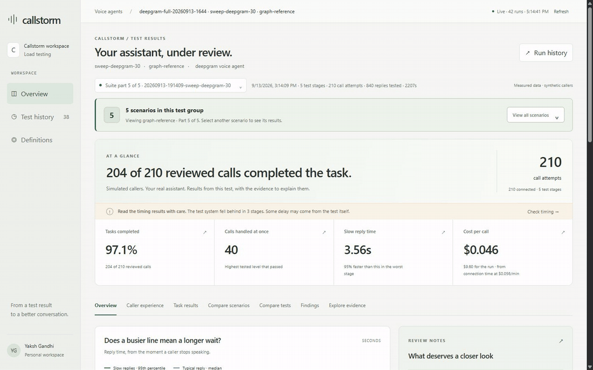
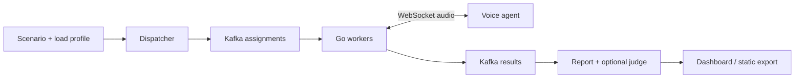

<div align="center">

# Callstorm

**Find the point where a voice agent stops holding a conversation.**

A Go load-testing harness that replays scripted callers, measures the wait they experience,
and checks whether the agent actually completed the task.

[](https://github.com/ai-calypse/callstorm/actions/workflows/ci.yml)
[](https://github.com/ai-calypse/callstorm/actions/workflows/codeql.yml)
[](LICENSE)

[Live dashboard](https://ai-calypse.github.io/callstorm/) · [Engineering report](docs/engineering-report.md) · [Technical guide](docs/technical-guide.md) · [Demo](docs/demo.md)



</div>

## Why build this?

A socket can connect and a response can arrive quickly while the assistant misunderstands the caller.
Callstorm keeps connection health, latency, conversation quality, and task success separate, with
call-level evidence behind each verdict. It also measures load-generator drift, so a saturated harness
cannot quietly blame the target.

## Engineering at a glance

| Design choice | What it makes possible | Inspect it |
| --- | --- | --- |
| One goroutine per call; bounded concurrency per load step | Compare each step against its own baseline | [Load generator](internal/loadgen/) |
| WebSocket PCM audio with cached caller speech | Replay identical input across runs | [Worker](internal/worker/) · [Audio](internal/audio/) |
| Kafka assignment/result bus | Distribute calls across replaceable workers | [Bus](internal/bus/) · [Deployments](deploy/) |
| Controlled local reference agent | Calibrate clocks against known injected delays | [Reference agent](cmd/refagent/) |
| Transcript criteria and optional LLM review | Distinguish fast replies from successful tasks | [Judge](internal/judge/) |
| File-based reports and static export | Share the same evidence locally and on Pages | [Dashboard](cmd/dashboard/) |



## Evidence worth opening

- **Tail latency under concurrency:** a committed five-scenario, 1,050-call suite shows why a flat median
  can hide a growing p95. [Measurements and interpretation](docs/engineering-report.md#evidence-from-the-repository).
- **Worker crash recovery:** the documented 48-call chaos run received all 48 results, dropping one
  duplicate. [Infrastructure verification](scripts/verify-infrastructure.py).
- **Measurement integrity:** negative timings, endpointing, clock definitions, and harness degradation
  are explained alongside the results. [Technical guide](docs/technical-guide.md).

These are historical experiment results from committed artifacts, with their original test conditions.
They are not guarantees for other agents, machines, or networks.

## Try the dashboard without credentials

Requires [Go 1.25+](go.mod). No calls are placed by this command.

```sh
git clone https://github.com/ai-calypse/callstorm.git
cd callstorm
go run ./cmd/dashboard -runs runs
```

Open `http://localhost:8090`. To generate the static site:

```sh
go run ./cmd/dashboard -runs runs -export dist
```

## Run a voice-agent test

```sh
cp .env.example .env
# Set DEEPGRAM_API_KEY in .env.
go run ./cmd/callstorm -scenario scenarios/refund.json -profile profiles/smoke-deepgram.json
```

Caller speech synthesis and live target calls can incur provider charges. Start with the smoke profile.
For calibration, run `go run ./cmd/refagent` and point the CLI at its local WebSocket endpoint;
caller speech synthesis still requires a Deepgram key unless the audio is already cached.
The [technical guide](docs/technical-guide.md) covers profiles, judging, Kubernetes, KEDA, and impairment tests.

## Quality and delivery

```sh
go test -race ./...
go vet ./...
go build ./cmd/...
npm ci --prefix cmd/dashboard/ui --ignore-scripts
npm run check --prefix cmd/dashboard/ui
```

Pull requests run race tests, formatting, vet, module verification, dashboard checks, static export,
workflow validation, documentation links, dependency review, and CodeQL. The validated dashboard
artifact from a successful `main` CI run is deployed to GitHub Pages. Version tags build CLI archives
and checksums into a draft release. [Maintenance and release process](docs/maintaining.md).

## Scope and contributing

The target protocol is Deepgram Voice Agent WebSocket. SIP/PSTN calling and other provider adapters
are not implemented. Recorded transcripts and target configuration need review before sharing.
The historical Go module path remains `github.com/yakshgandhi/callstorm`.

[Contributing](CONTRIBUTING.md) · [Security](SECURITY.md) · [MIT license](LICENSE)
